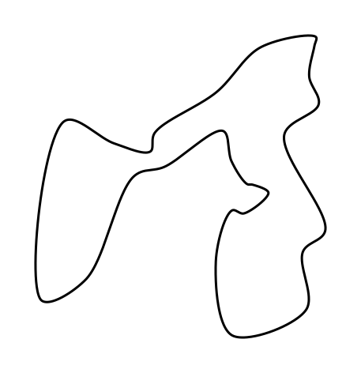
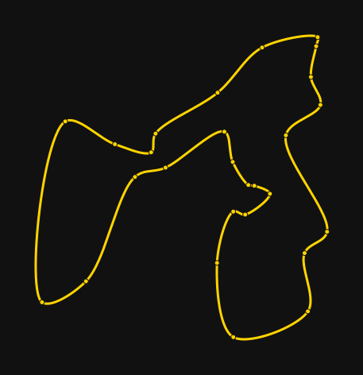
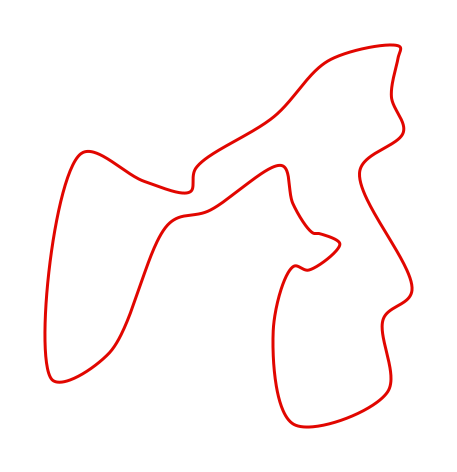
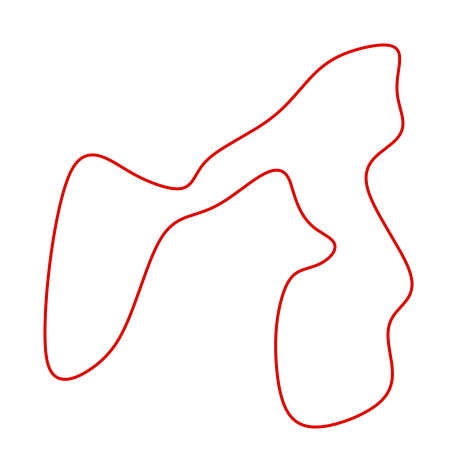
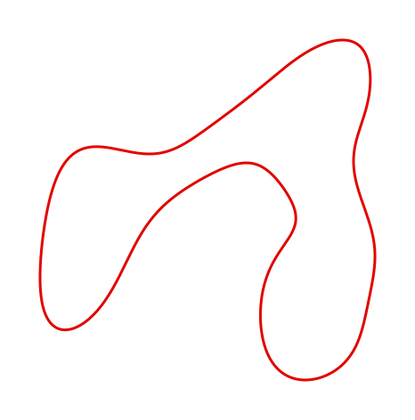
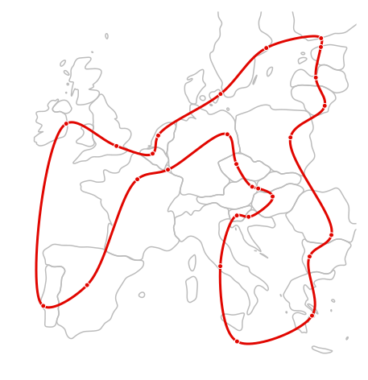
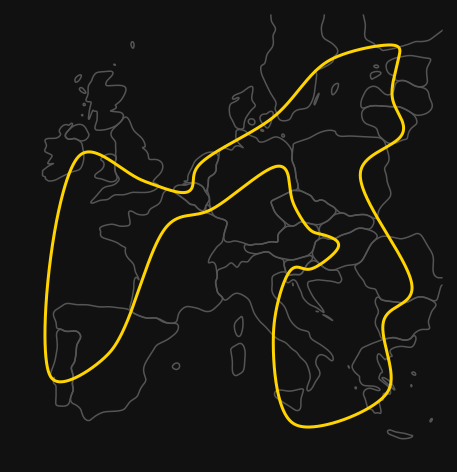

# trackoutline

[](https://pypi.org/project/trackoutline/)
[](https://github.com/cedricduriau/trackoutline/actions/workflows/ci.yml)
[](https://codecov.io/gh/cedricduriau/trackoutline)
[](https://github.com/cedricduriau/trackoutline/blob/main/pyproject.toml)
[](https://github.com/cedricduriau/trackoutline/blob/main/LICENSE)
[](https://github.com/astral-sh/ruff)

Turn a Google Maps directions link into a minimalist, closed, smooth track-circuit outline (PNG or SVG).

## Install

```
pip install trackoutline
```

From source: `pip install .` in a checkout (see Development for dev setup).

## Usage

```
trackoutline "<google maps /dir/ url>" -o track.png -c "#e10600" --markers
```

`python -m trackoutline ...` also works.

The output format follows the `-o` extension: `-o track.png` (default) or `-o track.svg`.
SVG stays sharp at any size and suits web pages; `--dpi` only affects PNG.

Options: `-c` line color, `--bg` background (or `none`), `-w` line width, `--size`, `--dpi`,
`--markers`, `--marker-color`, `--open` (don't close the loop), `--smoothing` (0 to 1, default 0),
`--borders`, `--border-color`, `--border-width`, `--border-alpha`.

`--smoothing` rounds off kinks: 0 passes through every waypoint, ~0.3 gives a clean shape, 1 is
very abstract. It works on closed loops only, and markers snap onto the smoothed curve.

`--borders` draws faint country borders under the route (off by default). `--borders` alone
shows every country in view; `--borders BE,FR,GB-SCT` limits it to ISO codes (`GB` selects
England, Scotland, Wales and Northern Ireland). Put the link before `--borders`, otherwise
the link is read as the list of codes. Borders follow `--smoothing` so route and borders stay
consistent, but are capped at 0.3 so they stay recognizable. At large scale (like the previews
below) even low values round borders heavily, so use small values such as 0.03.

Border data is Natural Earth 1:50m (public domain), simplified; regenerate it with
`python scripts/build_borders.py` in a checkout.

As a library:

```python
from trackoutline import create_outline

create_outline(url, output="track.png", color="#e10600", markers=True)
```

## Previews

All previews use the same route: the EU capitals (without Nicosia) plus London, joined into one
closed tour (`scripts/eu_capitals.py`). Regenerate them with `python scripts/build_previews.py`.

| Default | `-c "#e10600" --markers` | `-c "#ffd400" --bg "#111" --markers` |
| --- | --- | --- |
|  |  |  |

Smoothing:

| `--smoothing 0` | `--smoothing 0.1` | `--smoothing 0.3` |
| --- | --- | --- |
|  |  |  |

Borders (EU member states plus the UK, `--smoothing 0.03`):

| `--borders AT,BE,...,GB --markers` | `--borders AT,BE,...,GB --border-color "#555" --bg "#111"` |
| --- | --- |
|  |  |

## How it works

Waypoints come from the URL's embedded coordinates (`!1d<lon>!2d<lat>`), `lat,lon` path
segments, or DMS segments. Named places are geocoded with Nominatim (~1 request/s). Short
`maps.app.goo.gl` links are resolved via redirect. The curve is a closed centripetal
Catmull-Rom spline through the waypoints (it does not follow roads).

## Limitations

- Waypoints are joined in the order given, so a route that doubles back crosses itself.
- Named places depend on Nominatim; for exact pins use a link with embedded coordinates.
- Borders at 1:50m look coarse on small regional trips.
- Only Google Maps `/dir/` links are supported.

## Development

```
pip install -e ".[dev]"
ruff format .
ruff check .
pytest
```

`pytest` also reports line and branch coverage (`coverage.xml` is uploaded to Codecov by CI).
CI runs lint and tests on pull requests and on pushes to `main`.

## Releasing

Releases are tag-driven and the version is static in `pyproject.toml`.

1. Add entries under `## [Unreleased]` in `CHANGELOG.md` as you work.
2. On a clean `main`, run `python scripts/release.py prepare patch` (or `minor`, `major`, or an
   explicit `X.Y.Z`). Use `--dry-run` to preview. It runs lint and tests, bumps `pyproject.toml`,
   dates the changelog section, then commits and tags `vX.Y.Z`.
3. Push with `git push origin main vX.Y.Z` (or pass `--push` to step 2).

Pushing the tag starts `.github/workflows/release.yml`: it checks that tag, `pyproject.toml` and
changelog agree, runs CI, builds, publishes to TestPyPI, waits for approval of the `pypi`
environment, publishes to PyPI via trusted publishing, and creates the GitHub release with the
changelog section as notes.

## Layout

- `trackoutline/api.py`: parsing, geocoding, spline, rendering
- `trackoutline/borders.py`: border data loading, selection and smoothing
- `trackoutline/data/borders.json`: bundled simplified Natural Earth borders
- `trackoutline/cli.py`: argparse CLI
- `scripts/build_borders.py`: regenerates the border data
- `scripts/build_previews.py`: regenerates `docs/previews/`
- `scripts/eu_capitals.py`: the EU capitals tour used for the previews
- `docs/previews/`: generated SVG previews shown above
- `scripts/release.py`: version bump, changelog roll, tag and CI checks for releases
- `CHANGELOG.md`: release notes (the source for GitHub releases)
- `tests/`: pytest suite

## License

MIT, see `LICENSE`. Border data is from [Natural Earth](https://www.naturalearthdata.com/)
(public domain).
